# Анализ клиентского поведения и эффективности онлайн-продаж

## 1. Цель и задачи исследования

Цель исследования --- изучить поведение посетителей онлайн-платформы,
оценить характеристики покупок и конверсии, проверить статистические
свойства выборочных оценок и сформулировать практические рекомендации
для повышения эффективности продаж.

В работе использован набор данных из 5 000 наблюдений и 14 переменных.
Данные охватывают период с 1 января по 29 июня 2025 года. Основные
показатели исследования --- факт конверсии (`converted`) и сумма покупки
(`purchase_amount`).

В аналитической части рассматривались: - описательные характеристики
данных; - формирование случайной, стратифицированной и систематической
выборок объёмом 800 наблюдений; - сравнение выборочных оценок с
параметрами генеральной совокупности; - доверительные интервалы для
среднего чека и конверсии; - распределение выборочных средних при разных
объёмах выборки; - подбор теоретического распределения для сумм
покупок; - смещение выборочной оценки среднего; - связь клиентских
характеристик и поведения на сайте с коммерческими показателями.

## 2. Основные результаты и выводы

### 2.1. Характеристики генеральной совокупности

В генеральной совокупности 5 000 посетителей. Конверсия составляет
36,4%, то есть покупку совершили 1 820 клиентов. Средняя сумма покупки с
учётом нулевых значений составляет 34,93. При анализе размера чека среди
покупателей необходимо исключать посетителей, не совершивших покупку:
нулевые значения отражают отсутствие покупки, а не размер заказа.

Это различие важно для интерпретации показателей: - конверсия
характеризует вероятность покупки; - средний чек характеризует сумму
заказа среди покупателей; - выручка на посетителя учитывает и конверсию,
и размер покупки.

### 2.2. Сравнение методов формирования выборок

Для сравнения были сформированы три выборки объёмом 800 наблюдений:
простая случайная, пропорциональная стратифицированная по регионам и
систематическая с шагом, равным целой части отношения объёма генеральной
совокупности к объёму выборки.

  -----------------------------------------------------------------------------
  Метод отбора                Средний чек      Отклонение от      Относительное
                                                генерального         отклонение
                                                    среднего 
  -------------------- ------------------ ------------------ ------------------
  Систематическая                   34,30              −0,63              1,80%

  Стратифицированная                38,38              +3,45              9,88%

  Случайная                         29,78              −5,15             14,73%
  -----------------------------------------------------------------------------

Наиболее близкую оценку среднего чека в данном эксперименте дала
систематическая выборка: относительное отклонение составило 1,80%.
Стратифицированная выборка воспроизвела региональную структуру
генеральной совокупности с очень небольшими расхождениями, однако это не
обеспечило аналогичной точности оценки среднего чека.

Результат относится к конкретным реализованным выборкам. Он не
доказывает универсального превосходства систематического отбора: для
такого вывода потребовалось бы многократное повторение эксперимента с
разными случайными стартовыми точками и выборками.

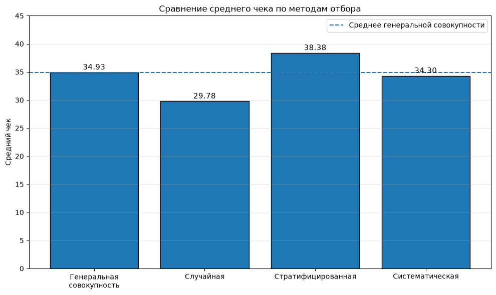
**График 1.** Сравнение среднего чека генеральной
совокупности и трёх выборок.

### 2.3. Доверительные интервалы

Фактический средний чек генеральной совокупности равен 34,93.
Рассчитанные 95%-е доверительные интервалы для среднего чека:

  Метод отбора           Нижняя граница   Верхняя граница Содержит 34,93
  -------------------- ---------------- ----------------- ----------------
  Случайная                       25,11             34,45 Нет
  Стратифицированная              32,15             44,61 Да
  Систематическая                 28,95             39,65 Да

Для конверсии фактическое значение составляет 36,4%. Все три 95%-х
интервала Уилсона включают это значение: - случайная выборка:
30,68--37,22%; - стратифицированная выборка: 34,21--40,91%; -
систематическая выборка: 32,99--39,64%.

Таким образом, в данном эксперименте стратифицированная и
систематическая выборки дали интервальные оценки среднего чека,
содержащие фактическое значение генеральной совокупности. Все три
выборки дали интервалы конверсии, включающие фактическую конверсию.

**Методологическое замечание.** Поправка на конечность генеральной
совокупности в использованном расчёте применена как приближение. Для
строгой оценки дисперсии стратифицированной и систематической выборок
необходимо учитывать особенности соответствующих схем отбора.
Стандартный интервал Уилсона для доли также не учитывает дизайн-эффект
сложной выборки.

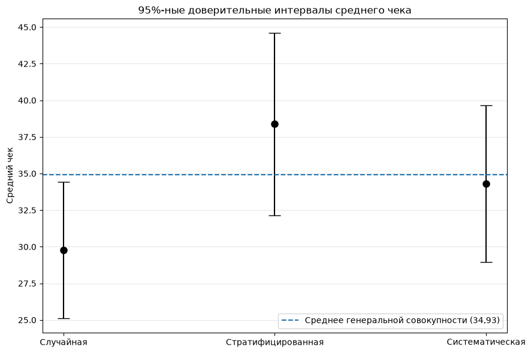
**График 2.** Доверительные интервалы среднего чека по трём
методам отбора с горизонтальной линией фактического среднего генеральной совокупности.

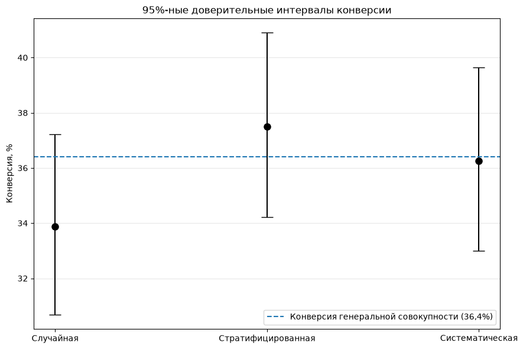
**График 3.** Доверительные интервалы конверсии с
горизонтальной линией фактической конверсии генеральной совокупности.

### 2.4. Центральная предельная теорема и закон больших чисел

Было проведено 1 000 повторных случайных отборов для каждого объёма
выборки: 5, 30 и 100 наблюдений. Для каждой выборки рассчитывалось
среднее значение `purchase_amount`.

  -----------------------------------------------------------------------
     Размер выборки           Среднее      Эмпирическая     Теоретическая
                           выборочных дисперсия средних         дисперсия
                              средних                   
  ----------------- ----------------- ----------------- -----------------
                  5            36,046         1 860,662         1 521,487

                 30            33,874           259,457           252,312

                100            34,921            73,681            74,627
  -----------------------------------------------------------------------

Среднее генеральной совокупности равно 34,93. При увеличении объёма
выборки среднее выборочных средних приближается к этому значению: для
выборки объёмом 100 оно составило 34,921.

Дисперсия выборочных средних заметно уменьшается с ростом объёма
выборки. Эмпирические и теоретические дисперсии достаточно близки для
размеров 30 и 100; для размера 5 расхождение выше, что согласуется с
большей изменчивостью средних малых выборок.

Результаты иллюстрируют закон больших чисел: при увеличении объёма
выборки выборочное среднее становится более устойчивой оценкой
генерального среднего. Центральная предельная теорема относится к форме
распределения выборочных средних; её визуальная проверка выполняется по
гистограммам и Q-Q-графикам.

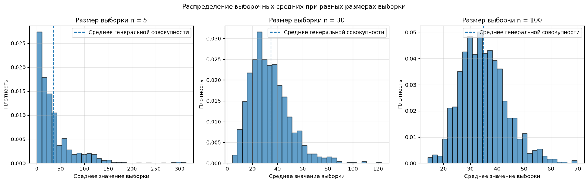
**График 4.** Гистограммы распределений выборочных средних для n = 5, 30 и 100.

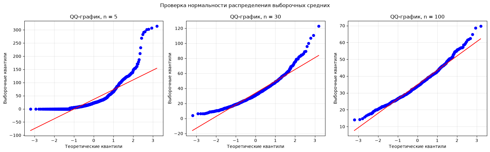
**График 5.** Q-Q-графики выборочных средних для n = 5, 30 и 100.

### 2.5. Подбор теоретического распределения для размера покупки

Для моделирования размера покупки рассматривались только клиенты,
совершившие покупку и имеющие положительное значение `purchase_amount`.
Сравнивались логнормальное и гамма-распределения.

  Распределение             AIC   KS statistic
  --------------- ------------- --------------
  Логнормальное     19 724,3277          0,067
  Гамма             20 222,0018          0,138

По обоим сравнительным критериям логнормальное распределение описывает
данные лучше: его AIC ниже, а статистика Колмогорова --- Смирнова
меньше. При этом стандартный KS-тест дал округлённое p-value 0,000 для
обеих моделей, то есть обе модели отвергаются при обычных уровнях
значимости.

Следовательно, логнормальное распределение является более подходящим из
двух рассмотренных вариантов, но не обеспечивает полного соответствия
эмпирическим данным. Визуальная оценка графиков сама по себе не должна
перевешивать результаты количественного сравнения.

**Методологическое замечание.** Параметры распределений оценивались по
той же выборке, на которой проводился KS-тест. Поэтому стандартные
p-value KS-теста не являются точными без дополнительной процедуры,
например параметрического bootstrap. AIC корректно использовать для
сравнительного выбора между моделями, подогнанными к одной и той же
выборке и одной целевой переменной.

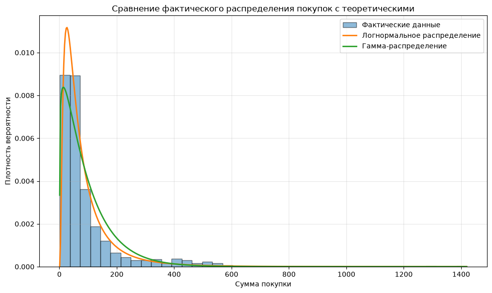
**График 6.** Гистограмма положительных сумм покупок с наложенными логнормальной и гамма-плотностями.

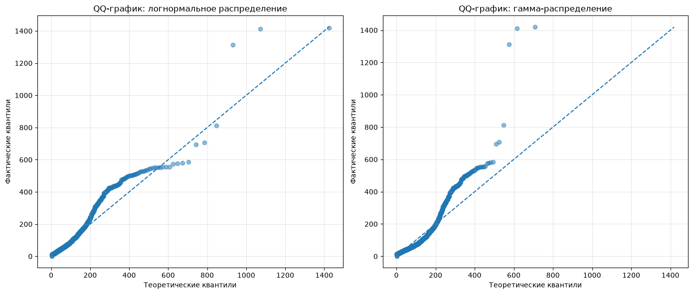
**График 7.** Q-Q-графики для логнормального и гамма-распределений.

### 2.6. Смещение и устойчивость выборочной оценки

Для размеров выборки 10, 50 и 200 было проведено по 1 000 повторных
случайных отборов. Смещение определялось как разность между выборочным и
генеральным средними.

  -----------------------------------------------------------------------
     Размер выборки  Среднее смещение           Среднее       Стандартное
                                             абсолютное        отклонение
                                             отклонение          смещения
  ----------------- ----------------- ----------------- -----------------
                 10            −1,117            21,643            28,205

                 50            +0,493             9,280            11,879

                200            +0,093             4,653             5,841
  -----------------------------------------------------------------------

Среднее смещение во всех трёх экспериментах относительно невелико и
приближается к нулю при увеличении размера выборки. Среднее абсолютное
отклонение и стандартное отклонение смещения последовательно
сокращаются.

Это согласуется с несмещённостью выборочного среднего при случайном
отборе и показывает, что увеличение объёма выборки повышает точность и
устойчивость оценки.

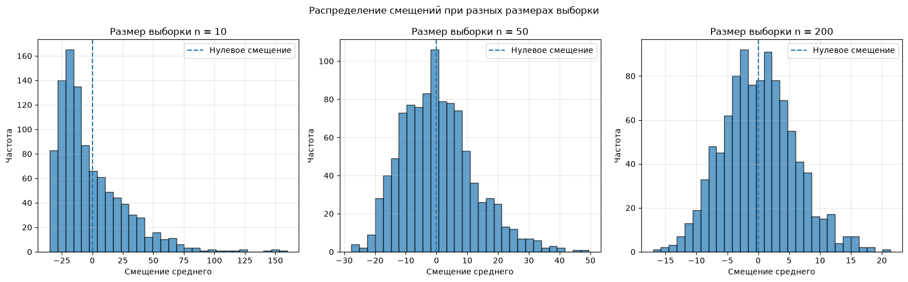
**График 8.** Распределения смещения среднего при размерах выборки 10, 50 и 200.

### 2.7. Факторы, связанные с коммерческими показателями

Для бизнес-анализа использовались три показателя: - конверсия --- доля
посетителей, совершивших покупку; - средний чек --- средняя сумма
покупки среди покупателей; - выручка на посетителя --- среднее значение
`purchase_amount` по всем посетителям, включая нулевые покупки.

#### Регион

  -----------------------------------------------------------------------
  Регион             Клиенты   Конверсия, %     Выручка на    Средний чек
                                                посетителя 
  ----------- -------------- -------------- -------------- --------------
  East                 1 579          35,15          36,65         104,28

  South                1 235          37,25          35,66          95,73

  West                 1 011          37,59          34,51          91,80

  North                1 175          36,17          32,20          89,03
  -----------------------------------------------------------------------

East лидирует по выручке на посетителя и среднему чеку. South и West
имеют более высокую конверсию. North демонстрирует минимальные средний
чек и выручку на посетителя.

#### Источник трафика

  -----------------------------------------------------------------------
  Источник           Клиенты   Конверсия, %     Выручка на    Средний чек
                                                посетителя 
  ----------- -------------- -------------- -------------- --------------
  Referral               513          41,33          39,47          95,51

  Email                  737          36,50          35,65          97,67

  PaidAds              1 551          34,69          34,45          99,30

  Organic              2 199          36,43          33,97          93,25
  -----------------------------------------------------------------------

Referral --- наиболее эффективный источник по конверсии и выручке на
посетителя. Его преимущество связано прежде всего с более высокой
конверсией, а не с максимальным средним чеком. PaidAds имеет
сравнительно высокий средний чек, но более низкую конверсию.

#### Рекламные кампании

  -----------------------------------------------------------------------
  Кампания           Клиенты   Конверсия, %     Выручка на    Средний чек
                                                посетителя 
  ----------- -------------- -------------- -------------- --------------
  CAMP7                  219          38,81          44,08         113,58

  CAMP1                  223          34,53          39,29         113,78

  CAMP5                  215          38,60          35,05          90,79

  CAMP4                  221          31,67          34,23         108,08

  CAMP6                  205          39,02          33,42          85,65

  CAMP3                  212          31,13          31,91         102,51

  CAMP2                  256          30,08          24,58          81,70
  -----------------------------------------------------------------------

CAMP7 обеспечивает максимальную выручку на посетителя и высокую
конверсию. CAMP1 имеет максимальный средний чек. CAMP2 показывает
наиболее низкие значения по всем трём коммерческим показателям. CAMP6
отличается высокой конверсией, но сравнительно небольшим средним чеком.

В анализ кампаний вошли только 1 551 наблюдение с заполненным полем
`campaign`; пропуски присутствовали у 3 449 записей. Поэтому выводы по
кампаниям относятся только к наблюдениям с известной кампанией.

#### Возраст

  ------------------------------------------------------------------------
  Возрастная          Клиенты   Конверсия, %     Выручка на    Средний чек
  группа                                         посетителя 
  ------------ -------------- -------------- -------------- --------------
  До 19                   310          38,06          38,89         102,16

  20--30                1 887          37,94          36,64          96,56

  31--45                1 742          35,30          33,70          95,47

  46--60                  868          34,33          32,95          95,96

  Старше 60               193          37,82          31,79          84,05
  ------------------------------------------------------------------------

Группа до 19 лет показывает наиболее высокие выручку на посетителя и
средний чек. Группа 20--30 лет также демонстрирует высокие коммерческие
показатели. У клиентов старше 60 лет средний чек минимален. При
интерпретации крайних возрастных групп следует учитывать их меньшую
численность.

#### Время на сайте

  -----------------------------------------------------------------------
  Время на           Клиенты   Конверсия, %     Выручка на    Средний чек
  сайте                                         посетителя 
  ----------- -------------- -------------- -------------- --------------
  До 2 минут             717          13,67          12,95          94,73

  2--5 минут           1 729          24,29          23,10          95,11

  5--10 минут          1 784          42,26          40,34          95,44

  Более 10               770          71,17          69,41          97,53
  минут                                                    
  -----------------------------------------------------------------------

Время на сайте демонстрирует наиболее выраженную описательную связь с
конверсией: с увеличением продолжительности посещения конверсия
последовательно растёт. Средний чек при этом меняется незначительно.
Следовательно, различия в выручке на посетителя между группами связаны
главным образом с различиями в конверсии.

Эта связь не доказывает, что искусственное увеличение времени пребывания
вызовет рост продаж: продолжительное посещение может быть следствием уже
возникшего намерения купить.

#### Количество просмотренных страниц

  ---------------------------------------------------------------------------
  Просмотренные          Клиенты   Конверсия, %     Выручка на    Средний чек
  страницы                                          посетителя 
  --------------- -------------- -------------- -------------- --------------
  1--3 страницы              657          37,75          37,21          98,58

  4--6 страниц             2 426          36,73          35,41          96,41

  7--9 страниц             1 575          35,37          33,00          93,32

  Более 9 страниц            342          36,26          36,01          99,31
  ---------------------------------------------------------------------------

Количество просмотренных страниц не демонстрирует столь же выраженной
монотонной связи с конверсией, как время на сайте. Наибольшая выручка на
посетителя наблюдается у группы, просмотревшей 1--3 страницы. Это может
указывать на значимость удобства навигации и быстрого поиска нужного
товара, однако для подтверждения гипотезы нужны дополнительные
исследования.

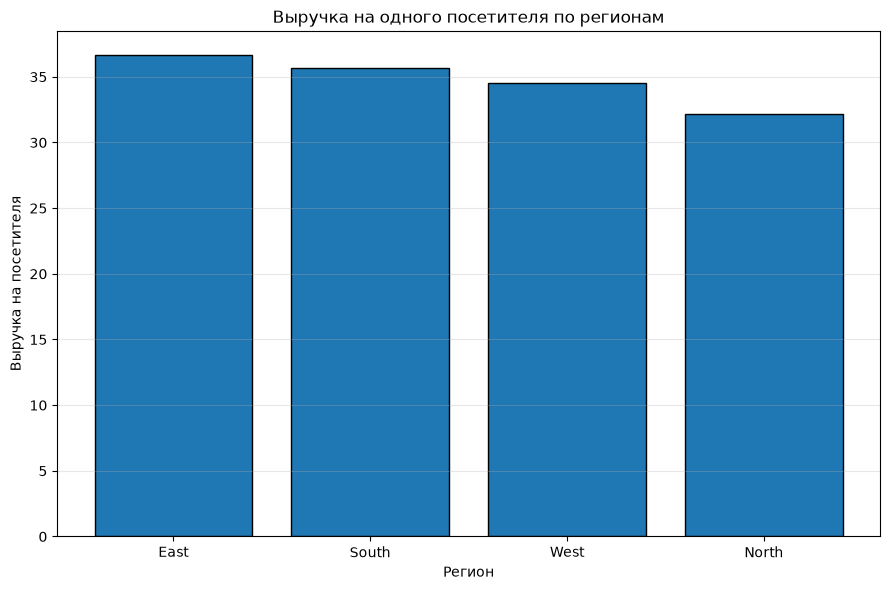
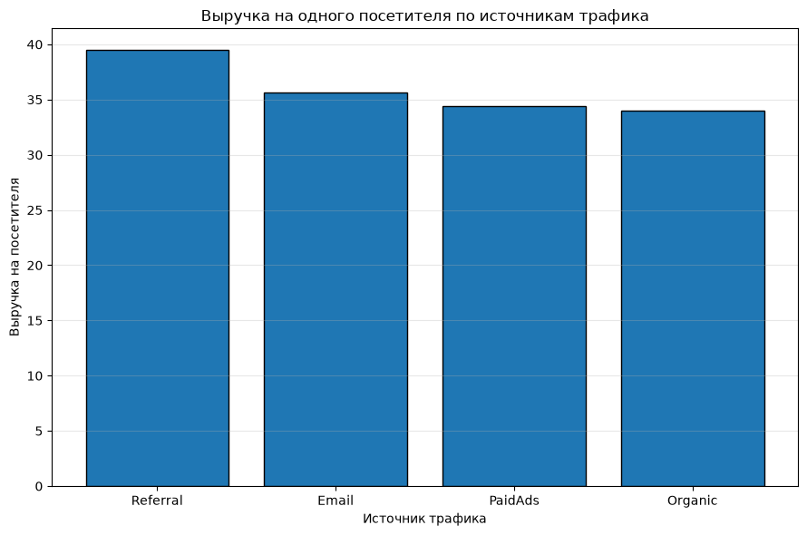
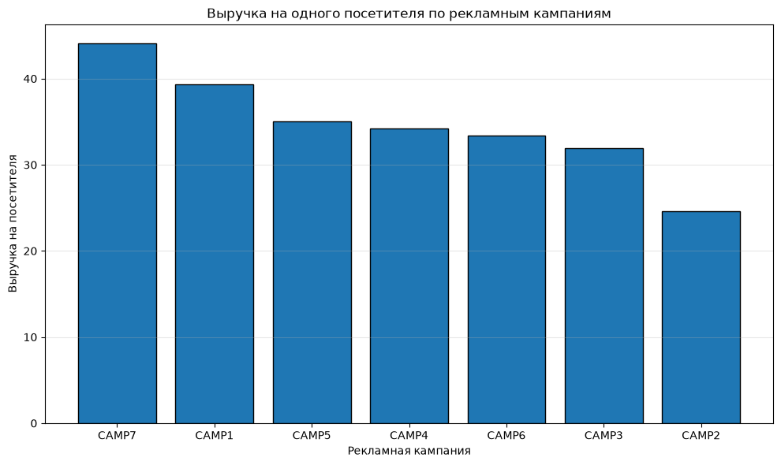
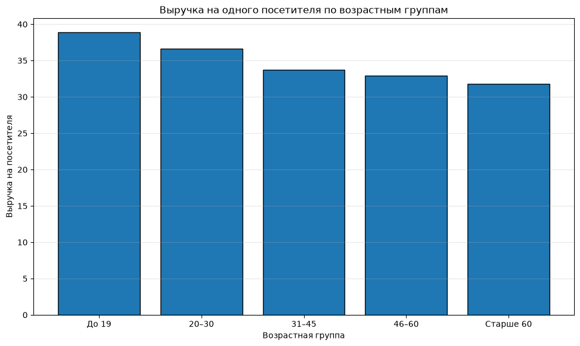
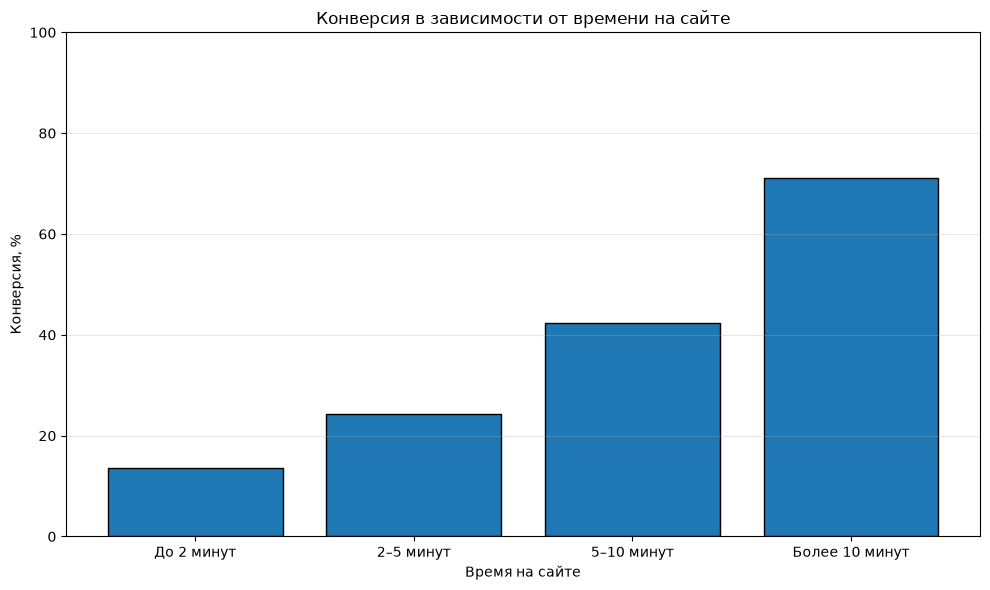
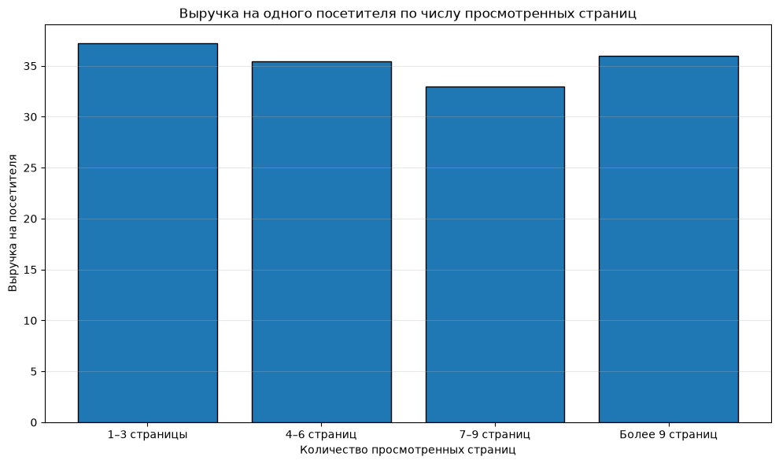
Графики 9-14.** Сравнение выручки на посетителя по регионам, источникам трафика, кампаниям, возрастным группам, времени на сайте и числу просмотренных страниц.

## 3. Бизнес-рекомендации

### 3.1. Развивать реферальный канал привлечения

Referral показал максимальные конверсию (41,33%) и выручку на посетителя
(39,47). Рекомендуется изучить действующие механики рекомендаций,
определить наиболее результативные аудитории и оценить возможности
масштабирования канала.

Перед увеличением бюджета необходимо сопоставить выручку с затратами на
привлечение, скидками и стоимостью вознаграждений. Целевой показатель
--- не только конверсия, но и маржинальная прибыль на привлечённого
клиента.

### 3.2. Изучить практики наиболее результативных кампаний

CAMP7 имеет максимальную выручку на посетителя (44,08), а CAMP1 ---
максимальный средний чек (113,78). Рекомендуется изучить их аудитории,
предложения, креативы и пользовательские сценарии. Для CAMP2 следует
проверить качество трафика, соответствие рекламного обещания содержанию
посадочной страницы и причины низкой конверсии и среднего чека.

Не следует автоматически отключать или масштабировать кампании только на
основании выручки: для полноценного решения необходимы расходы,
стоимость привлечения, маржа и возвраты.

### 3.3. Использовать региональную сегментацию

East лидирует по среднему чеку и выручке на посетителя, тогда как South
и West имеют более высокую конверсию. Рекомендуется исследовать различия
ассортимента, ценовой чувствительности, доступности доставки и структуры
спроса между регионами.

Для North целесообразно проверить ассортиментное соответствие и причины
относительно низкого среднего чека. Успешные практики East можно
использовать как гипотезы для тестирования в других регионах, а не
переносить без проверки.

### 3.4. Улучшать пользовательский путь

Конверсия существенно выше среди посетителей, проводящих на сайте больше
времени. Рекомендуется анализировать последовательность действий
пользователей, точки выхода, переходы к карточке товара, корзине и
оформлению заказа.

Практические меры: - упростить поиск и фильтрацию товаров; - сделать
условия доставки и оплаты понятными; - сократить количество лишних шагов
оформления; - улучшить информативность карточек товаров; - отдельно
анализировать сценарии посетителей с короткими сессиями.

Цель --- устранить препятствия на пути к покупке, а не искусственно
увеличивать длительность посещения сайта.

### 3.5. Проверять гипотезы по возрастным сегментам

Группы до 19 лет и 20--30 лет показывают высокие значения выручки на
посетителя. Можно проверить гипотезы о предпочтениях этих аудиторий,
релевантности ассортимента и форматах коммуникации. При этом возрастные
различия следует использовать для тестирования персонализации, а не для
жёсткого ограничения предложений.

### 3.6. Ввести систему регулярного мониторинга

Рекомендуется отслеживать в единой панели: - конверсию; - средний чек; -
выручку и маржинальную прибыль на посетителя; - стоимость привлечения
клиента; - конверсию по этапам воронки; - показатели по регионам,
каналам и рекламным кампаниям; - долю пропусков в данных о рекламных
кампаниях.

Это позволит оценивать не только объём продаж, но и экономическую
эффективность маркетинговых решений.

## 4. Ограничения исследования

1.  Анализ носит преимущественно описательный характер. Выявленные
    зависимости не доказывают причинно-следственное влияние.
2.  В поле `campaign` отсутствуют значения для значительной части
    наблюдений, поэтому выводы по рекламным кампаниям основаны на
    неполной подвыборке.
3.  Численность отдельных сегментов отличается; выводы по малочисленным
    группам требуют осторожности.
4.  В данных отсутствуют затраты на маркетинг и сведения о
    маржинальности, поэтому выручка не равна прибыли и не позволяет
    напрямую оценить рентабельность каналов.
5.  Результаты сравнения методов отбора относятся к конкретным
    реализованным выборкам.
6.  При подборе распределений обе рассмотренные модели были отвергнуты
    стандартным KS-тестом; логнормальная модель оказалась лучше только
    относительно гамма-модели.
7.  Для строгой оценки доверительных интервалов сложных выборок
    необходимо учитывать дизайн отбора.

## 5. Итоговое заключение

Исследование показало, что увеличение объёма выборки повышает
устойчивость оценок среднего чека, а систематическая выборка в
проведённом эксперименте дала наиболее близкую к генеральной
совокупности оценку среднего. Моделирование выборочных средних
подтвердило сокращение их дисперсии при увеличении объёма выборки.

В бизнес-части наиболее заметными результатами стали высокая выручка на
посетителя в канале Referral и кампании CAMP7, лидерство региона East по
среднему чеку, а также выраженная описательная связь времени пребывания
на сайте с конверсией. Количество просмотренных страниц, напротив, не
показало столь же последовательной зависимости.

Практический приоритет --- развивать эффективные каналы и кампании после
проверки их прибыльности, исследовать региональные различия, улучшать
пользовательский путь и внедрить регулярный мониторинг конверсии,
среднего чека, выручки и маржинальной прибыли. Все выявленные
закономерности следует рассматривать как основу для дальнейших проверок
и контролируемых экспериментов, а не как доказанные причинные эффекты.
